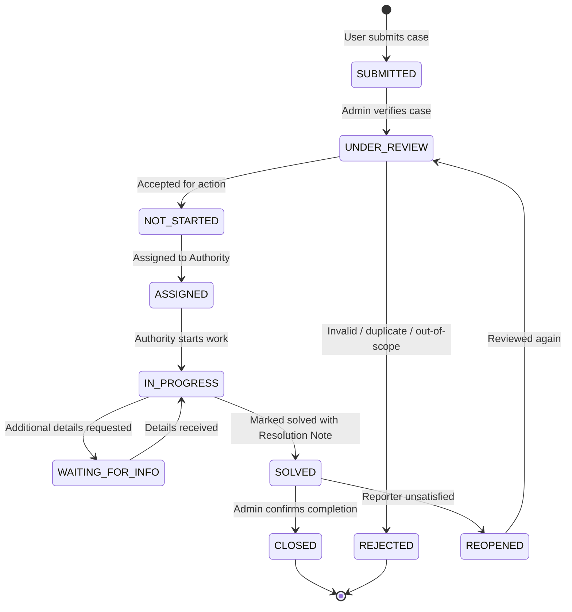

# Faculty Complaint and Suggestion Management App (FMSC)
**ITC 3380: Programming Applications and Frameworks (June 2026)**  
*Continuous Assessment Project · Faculty of Management Studies and Commerce, University of Sri Jayewardenepura*

---

## 1. Project Overview
This repository contains the Django-based **Faculty Complaint and Suggestion Management Portal**, designed and developed according to the formal software project proposal prepared by **Dr. Colombage Ranil Peiris** for the Faculty of Management Studies and Commerce (FMSC), University of Sri Jayewardenepura.

The platform provides a structured digital channel for students and lecturers to report issues and improvement suggestions with image/video evidence, provides administrators with review and authority assignment workflows, enforces a **10-stage case lifecycle**, and equips faculty leadership with real-time operational and management dashboards with **ageing reports**.

---

## 2. System Architecture & Key Features

### 2.1 Six Stakeholder Roles (Section 6)
1. **Student**: Submit complaints/suggestions, upload photo/video evidence, track status, view notifications.
2. **Lecturer**: Report academic, administrative, infrastructure, and student service issues.
3. **Administrator**: Review submissions, verify category/priority, assign cases to authorities, reject invalid entries, close confirmed cases.
4. **Relevant Authority** (*Maintenance Division, IT Unit, Examination Unit, Dean's Office, etc.*): Work queue dashboard, progress comments, completion evidence uploads, mark as solved (mandatory resolution notes).
5. **Faculty Management / Dean**: Strategic dashboards, resolution rate (%), average resolution days, top categories, authority-wise pending load and average aging.
6. **System Administrator**: Full Django admin access, role assignment, user management, and audit log inspection.

### 2.2 10-Stage Case Lifecycle (Section 8)


### 2.3 Proposed Wireframes Implemented (Section 10)
- **Wireframe 1**: University Login Screen (`/accounts/login/`) with multi-identifier auth (Registration Number, Staff ID, or University Email).
- **Wireframe 2**: Student / Lecturer Home Screen (`/`) with summary counters (Submitted, In Progress, Solved), quick actions, and recent cases table.
- **Wireframe 3**: Case Submission Form (`/cases/submit/`) with Case Type, Priority, Category, Location, Title, Description, Image/Video upload, and mandatory Declaration checkbox.
- **Wireframe 4**: Admin Dashboard (`/dashboard/admin/`) with operational KPIs (Total, Attempted, Not Attempted, Not Started, Urgent), multi-field filters, and the **Not Started Age Report Table**.
- **Wireframe 5**: Admin Case Review & Assignment (`/cases/<id>/review/`) for category/priority adjustment, authority assignment, and internal notes.
- **Wireframe 6**: Authority Work Queue (`/dashboard/authority/`) displaying department pending queue, priority badges, and age in days.
- **Wireframe 7**: Case Progress Update & Closure (`/cases/<id>/update/`) with progress comment, completion proof upload, and mandatory resolution note (Criterion 17).
- **Wireframe 8**: Management Dashboard (`/dashboard/management/`) with Complaint vs Suggestion ratios, Urgent vs Normal distribution, Resolution Rate %, Average Resolution Days, Top Categories, and Authority-wise Aging metrics.

---

## 3. Group Work Division (2-Member Team Plan)
*Assessment: 40 Marks total (25 Group Marks + 15 Individual Contribution Marks).*  
To ensure both team members score maximum individual contribution marks, the workload is partitioned as follows:

| Component | Member 1 (Lead / Architecture & Core Workflow) | Member 2 (Analytics, Progress & Governance) |
|---|---|---|
| **User & Roles** | Custom User model (`accounts`), 6 user roles, registration number/email auth backend | Profile management views, user role navigation guards |
| **Case Submission** | Case submission form, validation, file upload security (25MB limit, video/image mime types) | My Cases filter/search engine (query, status, priority, type) |
| **Case Workflow** | Admin review & assignment view (Wireframe 5), authority assignment CRUD (Criterion 15) | Authority work queue (Wireframe 6), progress updates & completion proof upload (Wireframe 7) |
| **Lifecycle & Rules** | Case numbering logic (`FMSC-YYYY-XXXX`), 10-stage status transition engine | Criterion 17 validation (Resolution Note mandatory on Solved), case close and reopen handling |
| **Dashboards** | Admin Dashboard KPIs & multi-field filter engine (Wireframe 4) | Management Dashboard (Wireframe 8) & Authority-wise Average Ageing calculations |
| **Notifications & Audit** | In-app notification model, dispatch signals & unread badge context processor | Comprehensive Audit Trail logging (`audit`), IP capture, and timeline display |
| **Data & Demo** | Initial database schema migrations & settings | Comprehensive test data seeder (`seed_data` command) for the 20-min presentation |

---

## 4. Setup & Running Locally

### Prerequisites
- Python 3.10+ (Tested on Python 3.14)
- Git

### Installation Steps
```bash
# 1. Clone repository
git clone <your-github-repo-url>
cd <repo-folder>

# 2. Create and activate virtual environment
python -m venv venv

# On Windows:
.\venv\Scripts\activate
# On macOS/Linux:
source venv/bin/activate

# 3. Install dependencies
pip install -r requirements.txt

# 4. Run database migrations
python manage.py migrate

# 5. Populate turnkey test data for demonstration
python manage.py seed_data

# 6. Start development server
python manage.py runserver
```
Visit `http://127.0.0.1:8000/` in your browser.

---

## 5. Demo Credentials (For 20-Minute Presentation Demo)
All test accounts are pre-seeded with the password: `password123`

| Role | Username / Reg No | Name | Department / Unit |
|---|---|---|---|
| **System Admin** | `admin` | System Administrator | IT Systems (Full Access) |
| **Administrator** | `admin_officer` | Ruwan Senanayake | Faculty General Office |
| **Student 1** | `student1` (*or* `FMSC/2023/1042`) | Kasun Perera | Department of Accounting |
| **Student 2** | `student2` (*or* `FMSC/2023/2180`) | Nayanthi Silva | Department of Finance |
| **Lecturer** | `lecturer1` (*or* `EMP-FMSC-089`) | Dr. K. Wickramasinghe | Department of Information Technology |
| **Authority: Maintenance** | `maint_head` | Eng. Sunil Jayasinghe | Maintenance Division |
| **Authority: IT Unit** | `it_head` | Mrs. Nilmini Fernando | IT Unit |
| **Faculty Management** | `dean_management` | Prof. P. D. Nimal | Dean's Office |

*(Note: The login page includes quick pre-fill buttons for smooth live demonstrations without typing).*

---

## 6. Git & GitHub Collaboration Guidelines

### Step-by-Step GitHub Setup
1. **Create Repository on GitHub**:
   - Go to [github.com/new](https://github.com/new).
   - Name the repository: `fmsc-complaint-management-system`.
   - Set it to **Public** or **Private** (add team member as Collaborator under *Settings > Collaborators*).
2. **Push the Local Codebase**:
   ```bash
   git remote add origin https://github.com/<your-username>/fmsc-complaint-management-system.git
   git add .
   git commit -m "feat: initial project scaffolding and core architecture for FMSC portal"
   git push -u origin main
   ```
3. **Collaboration Workflow**:
   - Always create a feature branch before making changes:
     ```bash
     git checkout -b feature/your-feature-name
     ```
   - Commit changes with clear, descriptive messages:
     ```bash
     git commit -m "feat: implement authority progress update and resolution note validation"
     ```
   - Push and open a Pull Request (PR) on GitHub for the other member to review.
   - Pull the latest `main` before starting new tasks:
     ```bash
     git checkout main
     git pull origin main
     ```

---

## 7. AI Usage Documentation (Course Requirement)
In accordance with course guidelines, AI tools were utilized during the design and development phases as follows:
- **Requirement Engineering & Schema Mapping**: AI was utilized to analyze Dr. Ranil Peiris's formal proposal document, mapping out the preliminary data entities (Appendix A), the 10-stage lifecycle states, and role access controls.
- **Architecture Scaffolding**: AI assisted in configuring the modular Django application structure (`accounts`, `cases`, `authorities`, `categories`, `dashboard`, `notifications`, `audit`).
- **UI/UX Design**: AI helped convert the low-fidelity wireframes (Wireframes 1–8) into responsive Bootstrap 5 templates adhering to university color themes and accessibility practices.
- **Validation Logic**: AI assisted in crafting strict business rule enforcement (e.g., Acceptance Criterion 17 requiring mandatory resolution notes when marking cases as solved, and file size/extension validation).
- **Test Data Synthesis**: AI generated diverse test scenarios matching real faculty incidents (audio-visual issues, infrastructure leaks, classroom furniture, LMS timeout errors) to facilitate effective demonstration during the 20-minute presentation.
